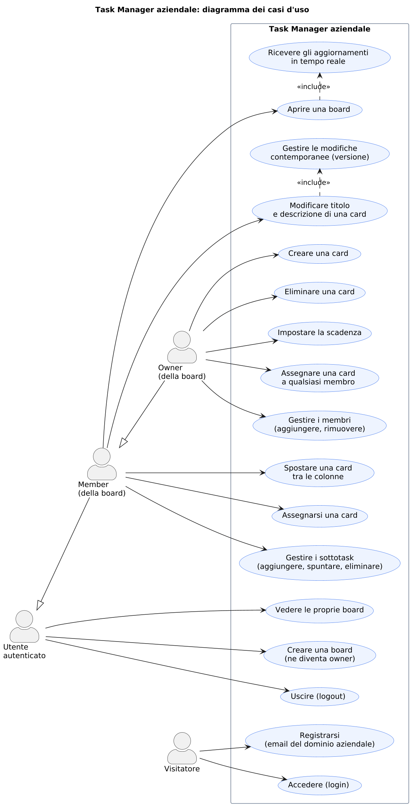
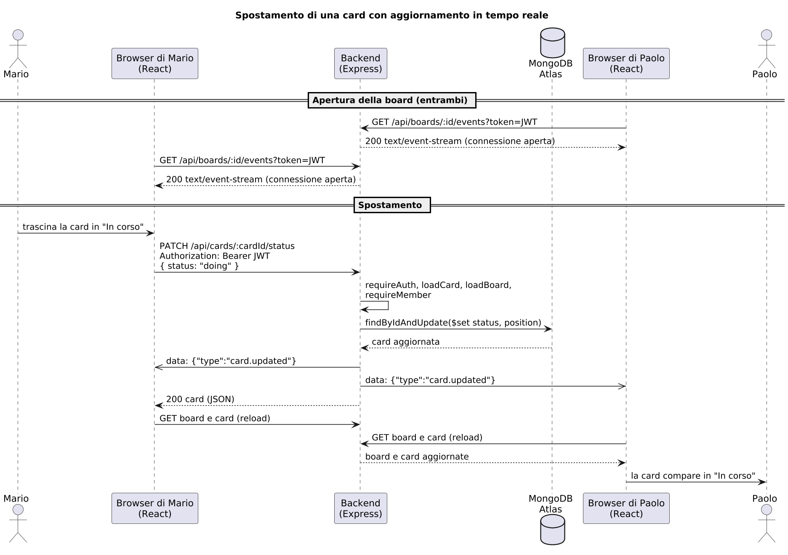

# Task Manager aziendale

Progetto d'esame di **Fondamenti del Web** (Politecnico di Bari, a.a. 2025/26).

Applicazione web full-stack per organizzare il lavoro di un team in **board** con quattro colonne (*Backlog, Da fare, In corso, Fatto*). Le card si spostano con il drag and drop, si assegnano ai membri, hanno scadenza e una checklist di sottotask, e si aggiornano **in tempo reale** su tutti i browser aperti sulla stessa board.

- **Applicazione online:** https://taskmanager-t1kg.onrender.com (credenziali di test nella sezione 3; al primo accesso il servizio gratuito può impiegare circa un minuto a ripartire)
- **Documentazione interattiva delle API (Swagger UI):** https://taskmanager-t1kg.onrender.com/api/docs
- **Codice:** https://github.com/PaoloUrbano/taskmanager

---

## 1. Scenario applicativo

Un'azienda vuole organizzare il lavoro dei suoi team con board Kanban condivise. Ogni dipendente si registra con la propria **email aziendale** (gli altri domini sono rifiutati). Chi avvia un progetto crea una **board**, ne diventa **owner** e invita i colleghi come **member**. L'owner crea le attività (**card**), le assegna e ne fissa le scadenze; tutti i membri le fanno avanzare tra le colonne *Backlog, Da fare, In corso, Fatto*, se le assegnano e spuntano i sottotask.

Due esigenze guidano le scelte tecniche:
- **lavoro contemporaneo**: chi guarda la stessa board vede subito le modifiche degli altri, senza ricaricare la pagina;
- **nessuna modifica persa**: se due persone correggono insieme lo stesso testo, la seconda viene avvisata invece di cancellare senza saperlo il lavoro della prima.

I ruoli **non sono globali**: la stessa persona può essere owner di una board e member di un'altra.

---

## 2. Casi d'uso



| Attore | Cosa può fare |
|---|---|
| Visitatore | registrarsi (solo con email del dominio aziendale) e accedere |
| Utente autenticato | vedere le board di cui fa parte, crearne di nuove (ne diventa owner), uscire |
| Member (di una board) | aprire la board e riceverne gli aggiornamenti in tempo reale, spostare le card, modificarne titolo e descrizione, assegnarsi una card, gestire i sottotask |
| Owner (di una board) | tutto ciò che fa il member, più: creare ed eliminare card, impostare le scadenze, assegnare le card a qualsiasi membro, aggiungere e rimuovere membri |

Member e owner sono specializzazioni dell'utente autenticato e valgono **per una singola board**. Rinomina ed eliminazione della board sono disponibili solo come API (sezione 7). Il sorgente dei diagrammi (PlantUML) è in `docs/`.

---

## 3. Avvio rapido

**Requisiti:** Node.js 20+ e un database **MongoDB in cloud** (MongoDB Atlas, piano gratuito M0).

```bash
# 1. Backend  ->  http://localhost:3000/api
cd backend
cp .env.example .env                 # su Windows: copy .env.example .env, poi inserire la stringa di Atlas in MONGO_URI
npm install
npm run seed                         # dati di prova (cancella e ricrea il database)
npm run dev

# 2. Frontend  ->  http://localhost:5173
cd ../frontend
npm install
npm run dev
```

In alternativa ad Atlas, per lavorare senza rete, `docker compose up -d` avvia MongoDB in locale: in quel caso `MONGO_URI=mongodb://localhost:27017/taskmanager`.

**Credenziali di test** (valgono anche per l'applicazione online; password per tutti: `password123`):

| Utente | Ruolo |
|---|---|
| `paolo@azienda.it` | owner di *Esame Fondamenti Web*, member di *Sito aziendale* |
| `anna@azienda.it` | owner di *Sito aziendale*, member di *Esame Fondamenti Web* |
| `mario@azienda.it` | member di entrambe |
| `luca@azienda.it` | in nessuna board |

**Prova del tempo reale:** apri la stessa board in una finestra normale (Paolo) e in una in incognito (Mario), poi sposta una card in una delle due.

### Variabili d'ambiente (`backend/.env`)
Il file `.env` non è nel repository perché contiene il segreto dei token: si crea copiando `backend/.env.example`.

| Variabile | Significato |
|---|---|
| `PORT` | porta del backend (3000 in locale; su Render la imposta la piattaforma) |
| `MONGO_URI` | stringa di connessione di MongoDB Atlas, con il nome del database: `mongodb+srv://<utente>:<password>@<cluster>.mongodb.net/taskmanager` |
| `JWT_SECRET` | segreto per firmare i token |
| `JWT_EXPIRES_IN` | durata del token (es. `8h`) |
| `ALLOWED_EMAIL_DOMAIN` | dominio ammesso in registrazione (vuoto = chiunque) |

---

## 4. Manuale d'uso

- **Registrazione e accesso.** Ci si registra con l'email del dominio aziendale. Non esistono ruoli globali.
- **Ruoli per board.** Chi crea una board ne diventa **owner** e può aggiungere altri utenti come **member** tramite la loro email. La stessa persona può essere owner di una board e member di un'altra.
- **Card.** L'owner crea le card (nascono in *Backlog*). Tutti i membri le spostano trascinandole tra le colonne. Un click apre il **dettaglio** in una finestra modale.

| Azione | Owner | Member |
|---|:---:|:---:|
| Gestire i membri (aggiungere, rimuovere) | SI | NO |
| Rinominare / eliminare la board (solo API, non ancora nell'interfaccia) | SI | NO |
| Creare / eliminare card | SI | NO |
| Modificare titolo e descrizione | SI | SI |
| Spostare una card tra le colonne | SI | SI |
| Assegnare una card | a chiunque della board, o a nessuno | solo a se stesso |
| Scadenza di una card | SI | NO |
| Sottotask (aggiungere, spuntare, eliminare) | SI | SI |

- **Modifiche contemporanee.** Se due persone modificano lo stesso contenuto, la seconda viene avvisata che la card è cambiata e vede la versione aggiornata, invece di cancellare senza saperlo il lavoro dell'altra.

---

## 5. Architettura

L'applicazione ha tre livelli (architettura **three-tier**):

1. **Client: una SPA React** che gira nel browser. Le pagine (`pages`) sono composte da componenti (`components`); i dati della board arrivano dall'hook `useBoard`, l'utente loggato da `AuthContext`. Tutte le chiamate al server passano da `api/client.js`, che aggiunge il token JWT e gestisce gli errori.
2. **Server: un'API REST con Express**, senza stato di sessione (l'utente è identificato dal JWT a ogni richiesta). Ogni richiesta passa dai router, dai middleware di autenticazione e permessi e poi dai controller, che leggono e scrivono il database con Mongoose.
3. **Database: MongoDB in cloud** (MongoDB Atlas), con tre collezioni: `users`, `boards`, `cards`.

Il client parla con il server in due modi:
- **richieste HTTP** su `/api/*`, con body e risposte in JSON;
- **uno stream SSE** per board (`/api/boards/:id/events`): il server avvisa i browser aperti su quella board quando qualcosa cambia, e loro ricaricano i dati.

In sviluppo Vite inoltra le richieste `/api` al backend sulla porta 3000; in produzione è Express stesso a servire anche il frontend compilato. In entrambi i casi per il browser è tutto sulla stessa origine, quindi non serve configurare CORS.

### Struttura delle cartelle

| Percorso | Contenuto |
|---|---|
| `package.json` | script di build e avvio per il deployment (installa backend e frontend, compila il frontend, avvia il backend) |
| `docs/` | diagrammi UML (casi d'uso, sequenza) e loro sorgenti PlantUML |
| `docker-compose.yml` | MongoDB in locale (facoltativo, alternativa ad Atlas) |
| `backend/app.js` | punto di ingresso: middleware globali, router, documentazione Swagger, frontend compilato (in produzione), 404, gestione degli errori |
| `backend/docs/` | specifica OpenAPI (`openapi.json`) e pagina Swagger UI |
| `backend/models/` | User, Board, Card (con i sottotask) |
| `backend/routes/` | auth; boards (con membri, card della board e stream SSE); cards (con i sottotask) |
| `backend/middleware/` | requireAuth (JWT); boardAccess (loadCard, loadBoard, requireMember, requireOwner); errorHandler |
| `backend/controllers/` | auth, boards, cards |
| `backend/services/events.js` | registro delle connessioni SSE e invio degli eventi |
| `backend/utils/httpError.js` | errore con lo status HTTP |
| `backend/seed.js` | dati di prova |
| `frontend/src/main.jsx`, `App.jsx` | punto di ingresso e rotte (React Router) |
| `frontend/src/api/client.js` | unico punto che fa fetch: token, JSON, errori, logout su 401 |
| `frontend/src/context/` | AuthContext: utente e token (salvati anche in localStorage) |
| `frontend/src/hooks/useBoard.js` | board e card, ricaricamento, EventSource |
| `frontend/src/pages/` | Login, Register, Boards, Board |
| `frontend/src/components/` | Column, CardItem, CardDialog, MembersPanel, SubtaskList, Layout, RequireAuth |

### Percorso di una richiesta (es. spostare una card)
`CardItem` (dragstart) -> `Column` (drop) -> `BoardPage.handleMove` -> `api.patch('/cards/:id/status')` -> proxy Vite -> Express -> `requireAuth` -> `loadCard` -> `loadBoard` -> `requireMember` -> `updateStatus` -> MongoDB -> `publish()` sullo stream della board -> risposta JSON -> `reload()` -> React ridisegna. Sugli altri browser l'evento SSE provoca lo stesso `reload()`.



### Deployment

L'applicazione è pubblicata su **Render** come un unico servizio web, collegato al repository GitHub:
- **build:** `npm run build` (dalla cartella principale: installa backend e frontend e compila il frontend in `frontend/dist`);
- **avvio:** `npm start` (avvia il backend, che serve le API su `/api` e la SPA su tutti gli altri percorsi);
- **variabili d'ambiente** impostate su Render: `MONGO_URI`, `JWT_SECRET`, `JWT_EXPIRES_IN`, `ALLOWED_EMAIL_DOMAIN`;
- il database è su **MongoDB Atlas**, raggiungibile dal server di Render (accesso di rete consentito da qualunque indirizzo, protetto da utente e password);
- Render fornisce **HTTPS**: password e token viaggiano cifrati.

---

## 6. Modello dati

```
User   { email (unique), password (hash bcrypt), name }
Board  { title, owner -> User, members -> [User] }
Card   { board -> Board, status: backlog|todo|doing|done, position,
         title, description, dueDate, assignee -> User | null,
         subtasks: [ { _id, title, done } ],              sottotask come sottodocumenti
         createdBy -> User, __v (versione) }                 collezione separata
```

- **Card in una collezione separata** e non dentro la board: le card sono tante e modificate spesso da persone diverse. Dentro la board, ogni modifica riscriverebbe l'intero documento (perdita di aggiornamenti tra chi lavora su card diverse) e ci sarebbe il limite di 16 MB per documento.
- **Sottotask come sottodocumenti** della card: esistono solo dentro di lei, e ognuno ha un `_id` per poterlo modificare o eliminare singolarmente.
- **Ordine nella colonna**: `position` = istante dell'ultimo spostamento; la card spostata va in fondo.

### Integrità referenziale
MongoDB non ha chiavi esterne: la garantisce l'applicazione.

| Evento | Effetto | Equivalente SQL |
|---|---|---|
| Elimino una board | prima `Card.deleteMany`, poi la board | ON DELETE CASCADE |
| Rimuovo un membro | `$pull` dai membri + le sue card tornano senza assegnatario | ON DELETE SET NULL |
| Assegno a un non-membro | 400 | vincolo |

---

## 7. API REST

**Documentazione interattiva:** Swagger UI su `/api/docs` (in locale http://localhost:3000/api/docs); la specifica OpenAPI è in `backend/docs/openapi.json`. Per provare le rotte protette: login, copiare il token, pulsante *Authorize*.

Prefisso `/api`, body JSON. Tutte le rotte tranne registrazione e login richiedono l'header `Authorization: Bearer <jwt>` (lo stream SSE riceve il token come `?token=`, perché EventSource non può mandare header).

- **Accesso:** *pubblico* · *login* (utente autenticato) · *membro* (owner o member della board) · *owner* (solo il proprietario della board).
- **Errori:** sempre `{ "error": "messaggio" }`. 400 dati non validi · 401 non autenticato · 403 permesso mancante · **404 risorsa inesistente o board di cui non si è membri** (per non rivelarne l'esistenza) · 409 conflitto (email già registrata) · 412 versione cambiata · 428 If-Match mancante.
- Le risposte restituiscono le entità **popolate** (owner, members, assignee con `{ _id, name, email }`).
- Ogni scrittura riuscita su board o card pubblica un evento sullo stream SSE della board.
- **Colonna "UI":** SI = chiamata dall'interfaccia React; NO = disponibile e funzionante (si può chiamare con un client HTTP, per esempio curl o Postman), ma non ancora collegata a un comando dell'interfaccia.

### Autenticazione
| Metodo | Percorso | Accesso | Body | Risposta | UI |
|---|---|---|---|---|---|
| POST | /api/auth/register | pubblico | `{ email, password, name }` | 201 utente (senza password) · 400 · 403 dominio non ammesso (`ALLOWED_EMAIL_DOMAIN`) · 409 email già usata | SI |
| POST | /api/auth/login | pubblico | `{ email, password }` | 200 `{ token, user }` · 401 credenziali errate (messaggio unico) | SI |
| GET | /api/auth/me | login | - | 200 utente corrente | NO |

### Board e membri
| Metodo | Percorso | Accesso | Body | Risposta | Evento SSE | UI |
|---|---|---|---|---|---|---|
| GET | /api/boards | login | - | 200 board di cui sono owner o member | - | SI |
| POST | /api/boards | login | `{ title }` | 201 board (chi la crea ne è owner) | - | SI |
| GET | /api/boards/:id | membro | - | 200 board popolata (owner, members) | - | SI |
| PATCH | /api/boards/:id | owner | `{ title }` | 200 board · 400 · 403 | board.updated | **NO** |
| DELETE | /api/boards/:id | owner | - | 204, elimina anche tutte le card (cascade) · 403 | board.deleted | **NO** |
| POST | /api/boards/:id/members | owner | `{ email }` | 200 board · 400 se è l'owner · 404 utente inesistente | board.updated | SI |
| DELETE | /api/boards/:id/members/:userId | owner | - | 200 board; le sue card tornano senza assegnatario | board.updated | SI |

Aggiungere un membro usa `$addToSet`: aggiungerlo due volte non crea duplicati.

### Card
| Metodo | Percorso | Accesso | Body | Risposta | Evento SSE | UI |
|---|---|---|---|---|---|---|
| GET | /api/boards/:id/cards | membro | - | 200 card della board, ordinate per stato e posizione | - | SI |
| POST | /api/boards/:id/cards | owner | `{ title, description?, status?, dueDate? }` | 201 card · 400 · 403 | card.created | SI |
| GET | /api/cards/:cardId | membro | - | 200 card + header `ETag: "<versione>"` | - | NO |
| PATCH | /api/cards/:cardId | membro (dueDate: owner) | `{ title?, description?, dueDate? }` + header `If-Match` | 200 card + nuovo ETag · 403 se un member tocca dueDate · 412 · 428 | card.updated | SI |
| PATCH | /api/cards/:cardId/status | membro | `{ status }` | 200 card (va in fondo alla nuova colonna; stesso stato = nessuna scrittura) · 400 | card.updated | SI |
| PATCH | /api/cards/:cardId/assignee | membro | `{ userId \| null }` | 200 · owner: chiunque della board o null · member: solo se stesso, altrimenti 403 · 400 se non è membro | card.updated | SI |
| DELETE | /api/cards/:cardId | owner | - | 204 · 403 | card.deleted | SI |

L'interfaccia non usa `GET /api/cards/:cardId`: la versione per l'If-Match la prende dal campo `__v` della card già caricata con la lista.

**Perché stato, assegnatario e sottotask hanno endpoint dedicati** invece di stare nella PATCH generica:
1. **Concorrenza.** Titolo e descrizione sono testo libero che due persone possono riscrivere insieme -> serve l'optimistic locking (If-Match -> 412). Stato, assegnatario e sottotask sono un solo valore sovrascritto in modo atomico -> "vince l'ultimo" va bene. Con un'unica PATCH un drag and drop fallirebbe con 412 solo perché un altro ha corretto la descrizione.
2. **Permessi diversi.** Stato: tutti i membri · assegnatario: owner chiunque, member solo se stesso · scadenza: owner · sottotask: tutti i membri. Ogni rotta ha i suoi middleware e un controller corto.
3. **Effetti collaterali incapsulati.** Lo spostamento aggiorna anche `position`; l'assegnazione verifica che l'utente sia membro.
4. **Restano REST:** sono sotto-risorse della card (`/cards/:id/status` = "lo stato della card").

### Sottotask (atomici, niente If-Match)
| Metodo | Percorso | Accesso | Body | Operazione MongoDB | Evento SSE | UI |
|---|---|---|---|---|---|---|
| POST | /api/cards/:cardId/subtasks | membro | `{ title }` | `$push` | card.updated | SI |
| PATCH | /api/cards/:cardId/subtasks/:subId | membro | `{ done }` (true/false; 400 se manca) | `$set` con l'operatore posizionale `subtasks.$.done` | card.updated | SI |
| DELETE | /api/cards/:cardId/subtasks/:subId | membro | - | `$pull: { subtasks: { _id } }` | card.updated | SI |

Spuntare una checkbox mentre un altro modifica il titolo non deve dare 412: per questo sono atomici.

### Tempo reale (SSE)
| Metodo | Percorso | Accesso | Risposta | UI |
|---|---|---|---|---|
| GET | /api/boards/:id/events?token=… | membro | `text/event-stream`; messaggi `data: {"type":"card.updated","cardId":"…"}` | SI |

### Catena dei middleware (esempio)
```
router.patch("/:cardId", requireAuth, loadCard, loadBoard, requireMember, ctrl.updateContent)
                         401          404       404        404 se non membro; imposta req.isOwner
```
- `requireAuth` -> `req.user` dal JWT (401).
- `loadCard` -> `req.card` (404). `loadBoard` -> `req.board`, da `:id` oppure da `req.card.board` (404).
- `requireMember` -> 404 se non membro; imposta `req.isOwner`.
- `requireOwner` -> 403 se `!req.isOwner`.

---

## 8. Componenti React

I **dati scendono** come props (board, card), gli **eventi salgono** come callback (`onMove`, `onOpen`, `onChanged`). Le card vivono in un solo posto, l'hook `useBoard`: dopo ogni azione si ricarica e tutta la pagina si ridisegna in modo coerente.

| Componente o modulo | Ruolo |
|---|---|
| `main.jsx` | monta l'applicazione: StrictMode, BrowserRouter (React Router), AuthProvider |
| `App.jsx` | le rotte: `/login` e `/register` pubbliche; `/boards` e `/boards/:id` protette da `RequireAuth`, dentro `Layout` |
| `context/AuthContext.jsx` | stato globale dell'autenticazione (token e utente, salvati anche in localStorage), funzioni `login` e `logout`, hook `useAuth()` |
| `api/client.js` | unico punto che usa fetch: aggiunge il token, converte in JSON, trasforma le risposte di errore in eccezioni con lo status, logout automatico su 401 |
| `hooks/useBoard.js` | custom hook: carica board e card in parallelo, apre l'EventSource della board e ricarica a ogni evento; chiude lo stream nel cleanup |
| `components/RequireAuth.jsx` | protegge le rotte: senza token reindirizza a `/login` |
| `components/Layout.jsx` | barra in alto con il nome dell'utente e "Esci"; la pagina corrente compare in `<Outlet />` |
| `pages/LoginPage.jsx`, `pages/RegisterPage.jsx` | form controllati; dopo la registrazione il login è automatico |
| `pages/BoardsPage.jsx` | le board dell'utente (con il suo ruolo) e la creazione di una nuova board |
| `pages/BoardPage.jsx` | la board: creazione delle card (owner), le quattro colonne, il pannello dei membri, il dettaglio della card; gestisce lo spostamento |
| `components/Column.jsx` | una colonna: zona di rilascio del drag and drop HTML5 |
| `components/CardItem.jsx` | anteprima della card (titolo, scadenza, sottotask completati, assegnatario); trascinabile, al click apre il dettaglio |
| `components/CardDialog.jsx` | dettaglio nel `<dialog>` modale nativo: titolo, descrizione, scadenza (owner) e assegnatario, salvati con controllo di versione (If-Match); eliminazione (owner) |
| `components/SubtaskList.jsx` | checklist della card: aggiunta, spunta ed eliminazione immediate |
| `components/MembersPanel.jsx` | le persone della board; l'owner aggiunge (per email) e rimuove i membri |

---

## 9. Scelte progettuali

**Permessi come middleware componibili.** `loadBoard -> requireMember -> requireOwner`: ogni passo prepara ciò che serve al successivo (`req.board`, `req.isOwner`). I controller non ricontrollano i permessi.

**Endpoint dedicati per stato, assegnatario e sottotask** (invece di un'unica PATCH):
- *concorrenza diversa*: il testo libero ha bisogno del controllo di versione; uno stato o un assegnatario sono un solo valore sovrascritto in blocco, e "vince l'ultimo" è accettabile.
- *permessi diversi* per ciascun campo, in controller brevi;
- i sottotask si modificano uno per uno con update atomici sull'elemento dell'array (`$push`, operatore posizionale `subtasks.$.done`, `$pull`): spuntare una checkbox non deve mai fallire con 412 perché un altro ha corretto il titolo.

**Optimistic locking con gli header HTTP.** `GET /cards/:id` restituisce `ETag: "<versione>"`; `PATCH /cards/:id` richiede `If-Match` e aggiorna con `findOneAndUpdate({ _id, __v }, { $set, $inc: { __v: 1 } })`, un'unica operazione atomica. Versione cambiata -> **412 Precondition Failed**; header assente -> **428**. 

**Unicità e race condition.** Email: indice `unique` (errore 11000 -> 409). Membri: `$addToSet`, atomico e idempotente.

**Tempo reale con Server-Sent Events.** Uno stream per board; dopo ogni scrittura riuscita il server pubblica un evento e i client rileggono i dati (*refetch*: meno codice e nessuno stato incoerente, al costo di una richiesta in più). SSE invece di WebSocket perché il flusso serve solo dal server al client: le azioni restano chiamate REST, così autenticazione, validazione e permessi stanno in un solo punto. `EventSource` si riconnette da solo.

**Frontend.** SPA con React (funzioni e hook) e React Router. Un solo client HTTP (`api/client.js`) e un context per l'autenticazione. I dati della board stanno in un custom hook (`useBoard`), unica fonte di verità: le colonne sono calcolate con `filter` a ogni render. Drag and drop **HTML5 nativo**; dettaglio della card con l'elemento nativo `<dialog>`.

---

## 10. Sicurezza

- Password salvate con **bcrypt** mai restituite nelle risposte.
- **JWT** firmato con scadenza; messaggio d'errore unico nel login (nessuna enumerazione degli utenti).
- **Whitelist dei campi** in creazione e modifica.
- Validazione nel **backend** (Mongoose, `runValidators`); quella nei form è solo comodità.
- Descrizione in **testo semplice**: nessun XSS.
- Chi non è membro riceve 404: non ottiene l'informazione dell'esistenza della board.
- In produzione l'applicazione è servita in **HTTPS** (Render): password e token viaggiano cifrati.

---

## 11. Limiti noti e sviluppi futuri

- **Token in localStorage**: leggibile da JavaScript in caso di XSS. Alternativa: cookie HttpOnly.
- **Token SSE nella query string**: finisce nei log del server. Alternativa: cookie o ticket monouso a breve scadenza.
- **Registro SSE in memoria**: funziona con una sola istanza; con più istanze servirebbe un pub/sub condiviso.
- **HTTP/1.1**: ogni scheda con uno stream aperto occupa una delle 6 connessioni per dominio; con HTTP/2 il multiplexing risolve.
- **Nessuna transazione**: l'eliminazione a cascata non è atomica. L'ordine scelto (prima le card, poi la board) evita comunque card orfane.
- I JWT non sono revocabili prima della scadenza.
- **API pronte ma non ancora collegate all'interfaccia**: rinomina (`PATCH /boards/:id`) ed eliminazione (`DELETE /boards/:id`) della board, provate con un client HTTP.
- **Piano gratuito di Render**: dopo circa 15 minuti senza richieste il servizio si sospende e la prima richiesta successiva lo riavvia (attesa di circa un minuto).
